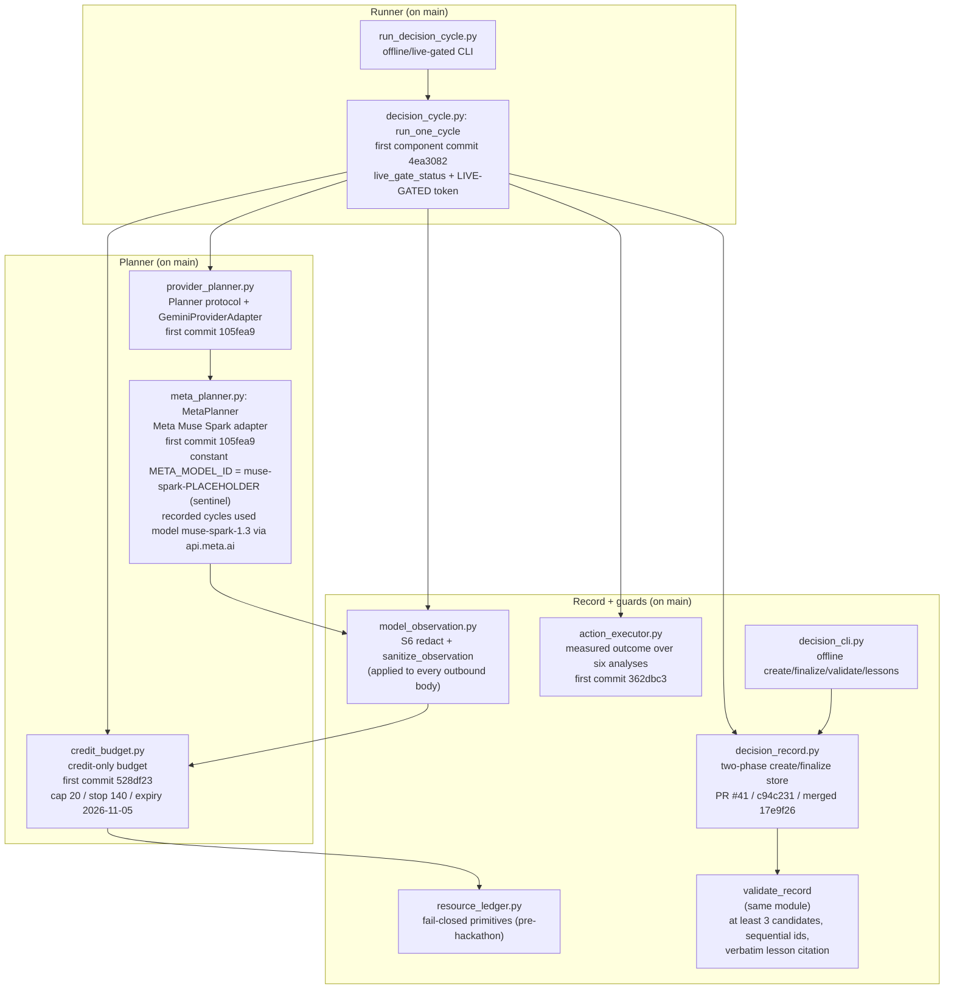

# SPRAY Architecture: Decision-Cycle Capability

This document shows the components and data flow of SPRAY's decision-cycle
capability: how a self-generated plan becomes a Decision Record whose
prediction is committed before acting, and how the record chain lets each
decision build on the last. Every box cites a real file/SHA/PR, and the legend
marks which components are **on `main`** and links them as local files.

## Legend (evidence location)

All decision-cycle components are now **on `main`** and safe to link as local
files:

- [`../../spray_schema/decision_record.py`](../../spray_schema/decision_record.py):
  two-phase create/finalize store plus `validate_record` (PR #41, first commit
  `c94c231`, merged via `17e9f26`).
- [`../../spray_schema/model_observation.py`](../../spray_schema/model_observation.py):
  S6 `redact` / `sanitize_observation`.
- [`../../spray_schema/resource_ledger.py`](../../spray_schema/resource_ledger.py):
  fail-closed budget primitives (pre-hackathon).
- [`../../scripts/decision_cli.py`](../../scripts/decision_cli.py): offline
  create/finalize/validate/lessons CLI.
- [`../../spray_schema/provider_planner.py`](../../spray_schema/provider_planner.py):
  provider-agnostic `Planner` protocol plus `GeminiProviderAdapter` (first
  commit `105fea9`).
- [`../../spray_schema/meta_planner.py`](../../spray_schema/meta_planner.py):
  `MetaPlanner` Meta Muse Spark adapter (first commit `105fea9`; the code
  constant `META_MODEL_ID` is the overridable sentinel `muse-spark-PLACEHOLDER`;
  API base `api.meta.ai`).
- [`../../spray_schema/credit_budget.py`](../../spray_schema/credit_budget.py):
  credit-only budget (first commit `528df23`).
- [`../../spray_schema/action_executor.py`](../../spray_schema/action_executor.py):
  measured-outcome executor over the six offline analyses (first commit
  `362dbc3`).
- [`../../spray_schema/decision_cycle.py`](../../spray_schema/decision_cycle.py):
  `run_one_cycle` plus `live_gate_status` plus the `LIVE-GATED` token (first
  component commit `4ea3082`).
- [`../../scripts/run_decision_cycle.py`](../../scripts/run_decision_cycle.py):
  offline/live-gated CLI.

The recorded cycles `decisions/D-0001.json` .. `decisions/D-0018.json` and the
per-cycle [`../../decisions/LEDGER.md`](../../decisions/LEDGER.md) (first commit
`b783358`) were produced with `provider = meta`, `model = muse-spark-1.3` via
`api.meta.ai`.

## Component / data-flow diagram



ASCII fallback (same flow, in case Mermaid is unavailable):

```
 [PLANNER on main]                      [RECORD + GUARDS on main]        [RUNNER on main]
 provider_planner.Planner  --+
   (+ GeminiProviderAdapter) |
 meta_planner.MetaPlanner  --+--> model_observation (S6 redact) --+
   (const muse-spark-PLACEHOLDER;|                                |
    cycles used muse-spark-1.3)  |                                |
 credit_budget  -------------+--> resource_ledger (fail-closed)   |
   (cap 20 / stop 140)                                            v
                                        decision_record.create_record (PREDICTED, outcome=null)
                                                 |
                                                 v
                                        validate_record (>=3 candidates, sequential id,
                                                 verbatim prior-lesson citation)
                                                 |
                                                 v
                                        action_executor -> decisions/artifacts/D-NNNN/ (repo-local)
                                                 |
                                                 v
                                        decision_record.finalize_record (FINALIZED,
                                                 actual_outcome + prediction_vs_actual + lesson)

 decision_cycle.run_one_cycle composes the whole left-to-right flow.
 decision_cli.py drives create/finalize/validate/lessons directly.
 run_decision_cycle.py is the live-gated CLI (prints LIVE-GATED when the gate is closed).
```

## Data flow, step by step

1. **Planner interface.** `provider_planner.Planner` (on `main`, first commit
   `105fea9`) is a provider-agnostic protocol exposing `provider`, `model_id`,
   and `choose(observation, target_text, history)`. `GeminiProviderAdapter`
   wraps the existing Gemini planner unchanged.
2. **Meta adapter.** `meta_planner.MetaPlanner` (on `main`, first commit
   `105fea9`) conforms to that protocol for Meta's Muse Spark models. Its API
   base host is `api.meta.ai` (OpenAI-compatible). The code constant
   `META_MODEL_ID` is the overridable sentinel `muse-spark-PLACEHOLDER`
   (settable via the `META_MODEL_ID` env var or `model_id` kwarg); the recorded
   cycles used `model = muse-spark-1.3` (recorded on every `decisions/D-*.json`
   and in `decisions/LEDGER.md`). The API key is header-only and read from
   `META_API_KEY`.
3. **S6 redaction.** `model_observation.redact` / `sanitize_observation`
   (on `main`) scrub secrets, tokens, URLs, and raw DOM out of **every**
   outbound request body before it leaves the process, and out of any
   observation-derived content before it is persisted.
4. **Credit ledger.** `credit_budget` (on `main`, first commit `528df23`)
   authorizes spend fail-closed (`authorize_meta_spend`) and composes the
   on-branch `resource_ledger` cash-zero primitives. It never modifies the
   ledger's behavior.
5. **Decision records.** `decision_record.create_record` (on `main`) writes the
   PREDICTED record to disk atomically before any action, then
   `finalize_record` fills only the outcome/comparison/lesson and flips status
   to FINALIZED.
6. **Validator.** `validate_record` (same module) enforces the chain rules
   (at least 3 candidates; non-empty scoring/prediction/choice; sequential ids;
   cited prior ids exist; verbatim prior-lesson citation; no ignoring available
   lessons; finalized records immutable).
7. **Executor and two signals.** `action_executor` (on `main`, first commit
   `362dbc3`) runs one of six offline analyses and records the measured
   outcome. Two orthogonal verdicts result: `outcome_verdict` HIT/MISS
   (executed analysis == chosen analysis **and** `fallback = false`, an R2-S7
   notion) and the separate numeric `within_range` signal on the
   `quantitative_claim` (R2-S8). They are independent: D-0014 is
   `outcome_verdict = MISS` yet numerically `within_range = true`, while D-0017
   and D-0018 are `outcome_verdict = HIT` yet numerically `within_range =
   false`.
8. **Runner.** `decision_cycle.run_one_cycle` (on `main`, first component commit
   `4ea3082`) composes all of the above and structurally enforces
   prediction-before-action ordering; `run_decision_cycle.py` is its
   live-gated CLI.

## Safety notes

- No credential-shaped literal appears in this diagram or prose; all API keys
  are read from the environment at runtime, never written here.
- Real decision cycles are recorded (`decisions/D-0001.json` ..
  `decisions/D-0018.json`), but no on-branch component makes a live model call
  during the test suite: the live path stays owner-gated (the gate prints a
  `LIVE-GATED` line and exits `0` when `META_API_KEY` is absent). As a
  historical note, the `api.meta.ai` base is the empirically reachable
  OpenAI-compatible API host; the `dev.meta.ai` console/docs host was
  tunnel-blocked from this sandbox and is not the inference host.

See [PROVENANCE.md](PROVENANCE.md) for the before/during build classification
and [README.md](README.md) for the problem statement and run instructions.
